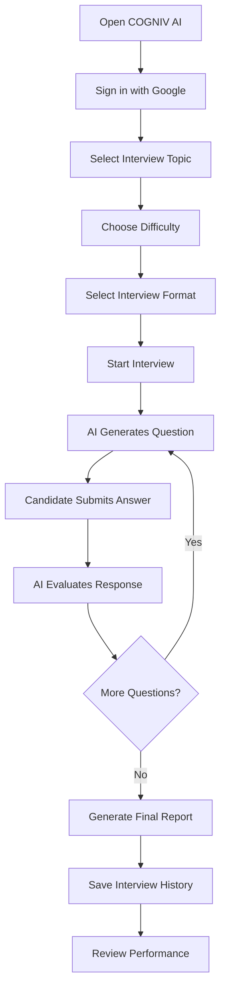
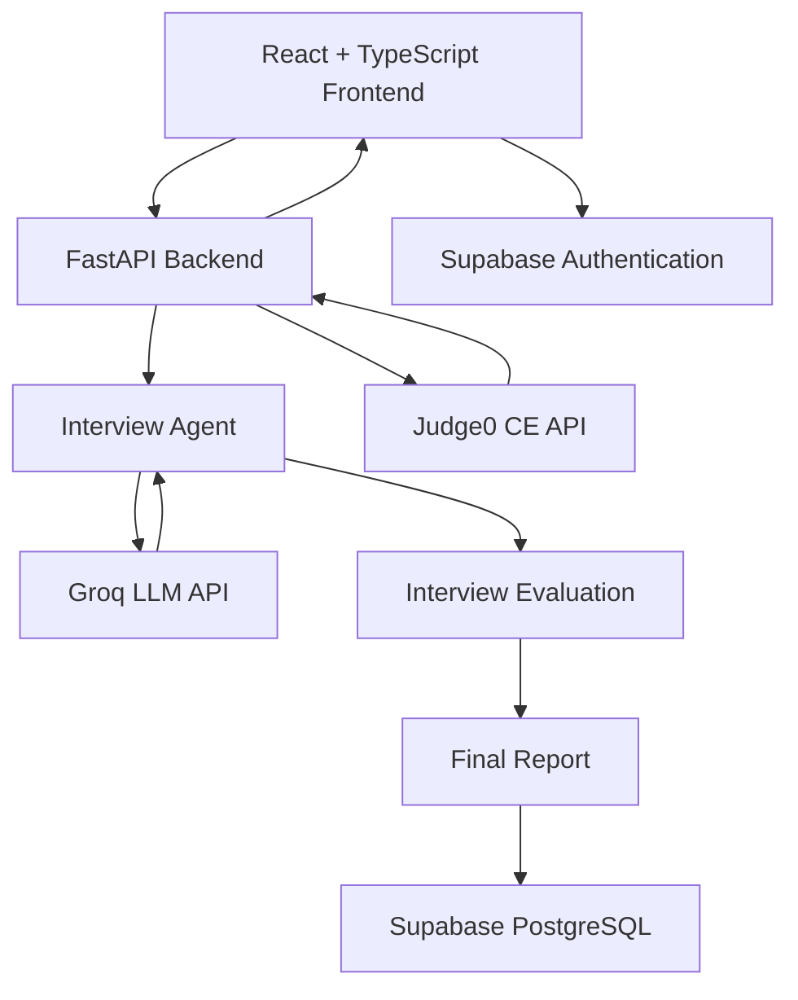

# COGNIV AI
### Think Beyond. Perform Better.

**An AI-Powered Technical Interview Preparation Platform**

COGNIV AI is an intelligent interview preparation platform designed to simulate real technical interviews using Generative AI. It allows candidates to practice technical concepts, solve coding problems, receive AI-generated feedback, and understand their interview performance through structured evaluation reports.

Instead of simply reading interview questions and answers, candidates can experience an interactive interview environment where an AI interviewer asks questions, evaluates responses, and progressively adapts the interview experience to the selected difficulty and format.

---

## Table of Contents

- [Overview](#overview)
- [Key Features](#key-features)
- [Interview Workflow](#interview-workflow)
- [Technology Stack](#technology-stack)
- [System Architecture](#system-architecture)
- [Project Structure](#project-structure)
- [Getting Started](#getting-started)
- [Environment Configuration](#environment-configuration)
- [Database Configuration](#database-configuration)
- [Google Authentication](#google-authentication)
- [API Endpoints](#api-endpoints)
- [Code Execution](#code-execution)
- [Security Considerations](#security-considerations)
- [Future Enhancements](#future-enhancements)
- [Contributing](#contributing)
- [License](#license)

---

## Overview

Technical interview preparation can be challenging, especially for students and fresh graduates who lack opportunities to practice in realistic interview environments.

COGNIV AI aims to address this challenge by providing an AI-powered interview experience that combines conversational AI, practical coding exercises, and structured performance evaluation.

Candidates can:

- Select their preferred technical interview topic.
- Choose an interview difficulty level.
- Select an interview format.
- Answer AI-generated interview questions.
- Write and execute code within the application.
- Receive feedback on their answers.
- Review their final interview performance.
- Track completed interview sessions.

The platform is being developed with a focus on making technical interview practice more interactive, accessible, and effective.

## Key Features

### 1. AI-Powered Technical Interviews

- Uses Groq-powered Large Language Models.
- Generates technical interview questions dynamically.
- Evaluates candidate responses.
- Asks one question at a time.
- Avoids repeating previously asked questions.
- Progressively increases question difficulty.

### 2. Multiple Interview Formats

Candidates can choose from three interview formats:

| Interview Mode | Description |
|---|---|
| Balanced | Combines conceptual questions and practical problem-solving exercises. |
| Technical Conversation | Focuses on conceptual understanding and technical explanations. |
| Coding & Problem Solving | Focuses on programming, implementation, algorithms, and practical exercises. |

### 3. Difficulty Levels

Candidates can select their preferred difficulty:

- Beginner
- Intermediate
- Advanced

### 4. Integrated Coding Environment

COGNIV AI includes a coding environment for practical interview preparation.

Features include:

- Integrated code editor.
- Programming language selection.
- Standard input support.
- Code compilation and execution.
- Compiler output and error display.
- Execution time and memory information.

Code execution is handled through the Judge0 CE API.

### 5. AI-Based Interview Evaluation

The AI interviewer evaluates candidate responses and provides structured feedback.

The interview experience includes:

- Short answer evaluations.
- Next-question generation.
- Practical versus conceptual question classification.
- Final interview performance reports.
- Knowledge and problem-solving assessment where applicable.
- Strengths and areas requiring improvement.

### 6. Interview History

Candidates can review their completed interview sessions.

The application supports:

- Completed interview history.
- Interview topic and difficulty information.
- Interview format and question count.
- Overall performance information.
- Supabase-backed report persistence.
- Browser-local practice history when Supabase history is not configured.

### 7. Authentication

- Google sign-in through Supabase Authentication.
- Authenticated interview API access.
- Server-side access-token verification.
- User-specific interview history.

---

## Interview Workflow

The application follows a structured interview process.



The AI interviewer follows a structured conversational process:

1. Generates an interview question.
2. Waits for the candidate's response.
3. Evaluates the response.
4. Generates the next question.
5. Continues until the interview is completed.
6. Produces a final interview report.

---

## Technology Stack

The project uses the following technologies:

| Category | Technologies |
|---|---|
| Frontend | React, TypeScript |
| Styling | Tailwind CSS |
| Frontend Build Tool | Vite |
| Backend | Python, FastAPI |
| AI Integration | Groq API |
| Language Model | OpenAI GPT-OSS-20B through Groq |
| Database | PostgreSQL through Supabase |
| Authentication | Supabase Auth, Google OAuth |
| Code Execution | Judge0 CE API |
| API Communication | HTTPX |
| Backend Validation | Pydantic |

---

## System Architecture

COGNIV AI follows a frontend-backend architecture.



**Frontend:** Handles the user interface, interview configuration, candidate responses, coding environment, and performance dashboards.

**Backend:** Handles interview sessions, AI communication, authentication verification, report generation, and API requests.

**AI Layer:** Uses Groq-hosted GPT-OSS-20B to generate interview questions and evaluate candidate responses.

**Database Layer:** Uses Supabase and PostgreSQL to maintain authenticated interview history.

**Code Execution Layer:** Uses Judge0 CE to execute submitted programming code in a sandboxed environment.

---

## Project Structure

```text
AI_Interview_Agent/
│
├── web/
│   ├── src/
│   │   ├── components/
│   │   ├── pages/
│   │   └── ...
│   ├── index.html
│   └── dist/
│
├── supabase/
│   └── migrations/
│       ├── 001_interview_sessions.sql
│       └── 002_auth_user_history.sql
│
├── agent.py
├── api.py
├── database.py
├── report.py
├── main.py
│
├── .env.example
├── .gitignore
├── package.json
├── package-lock.json
├── requirements.txt
├── tsconfig.json
├── vite.config.ts
│
└── README.md
```

---

## Getting Started

Follow these instructions to run COGNIV AI locally.

### Prerequisites

Make sure you have installed:

- Python 3.10 or later.
- Node.js and npm.
- Git.
- A Groq API key.
- A Supabase project.
- A Judge0 CE instance or access to the public Judge0 CE service.

### 1. Clone the Repository

```bash
git clone https://github.com/pavankl24/AI_Interview_Agent.git
```

Navigate into the project directory:

```bash
cd AI_Interview_Agent
```

### 2. Install Frontend Dependencies

```bash
npm install
```

### 3. Set Up Python Virtual Environment

Create a virtual environment:

```bash
python -m venv venv
```

Activate it.

**Windows:**

```powershell
venv\Scripts\activate
```

**Linux / macOS:**

```bash
source venv/bin/activate
```

### 4. Install Backend Dependencies

```bash
pip install -r requirements.txt
```

### 5. Configure Environment Variables

Create a `.env` file in the project root using the provided example:

```bash
cp .env.example .env
```

On Windows PowerShell:

```powershell
Copy-Item .env.example .env
```

Add your API credentials and configuration.

See [Environment Configuration](#environment-configuration).

### 6. Configure Supabase

1. Create a Supabase project.
2. Open the Supabase SQL Editor.
3. Execute the migration files in the following order:

```text
001_interview_sessions.sql
002_auth_user_history.sql
```

4. Configure the Supabase environment variables.
5. Enable Google Authentication.

See the database and authentication sections below.

### 7. Build the Frontend

```bash
npm run build
```

### 8. Start the FastAPI Backend

```bash
uvicorn api:app --reload
```

Open the application:

**http://127.0.0.1:8000**

The FastAPI backend serves the built frontend and handles live interview API requests.

### Frontend Development Mode

For frontend hot reloading during development, run:

```bash
npm run dev
```

Open:

**http://127.0.0.1:5173**

Keep the FastAPI backend running as well.

---

## Environment Configuration

The project uses environment variables to manage external service credentials.

Example `.env` configuration:

```env
# Groq API
GROQ_API_KEY=your_groq_api_key

# Judge0 Configuration
JUDGE0_API_URL=https://ce.judge0.com
JUDGE0_API_KEY=

# Supabase Backend Configuration
SUPABASE_URL=https://your-project.supabase.co
SUPABASE_SECRET_KEY=your_supabase_secret_key

# Supabase Frontend Configuration
VITE_SUPABASE_URL=https://your-project.supabase.co
VITE_SUPABASE_PUBLISHABLE_KEY=your_supabase_publishable_key
```

### API Key Setup

- **Groq:** Obtain your API key from [Groq Console](https://console.groq.com/).
- **Supabase:** Obtain project credentials from [Supabase Dashboard](https://supabase.com/dashboard).
- **Judge0:** Use the public CE endpoint or configure your own Judge0 instance.

Never commit your actual `.env` file or expose private API credentials.

---

## Database Configuration

COGNIV AI uses Supabase PostgreSQL to store completed interview reports.

### Database Migrations

The project contains two migration files:

| Migration | Purpose |
|---|---|
| `001_interview_sessions.sql` | Creates the interview session storage structure. |
| `002_auth_user_history.sql` | Adds authenticated user ownership for interview history. |

### Stored Interview Information

The application stores information such as:

- Authenticated user ID.
- Interview topic.
- Difficulty level.
- Interview format.
- Maximum question count.
- Overall score.
- Generated interview report.

Completed interview answers and transcripts are not stored as separate history records.

When Supabase history configuration is unavailable, the frontend can continue using browser-local practice history.

---

## Google Authentication

COGNIV AI uses Supabase Authentication with Google OAuth.

To configure Google sign-in:

1. Open your Supabase project.
2. Navigate to Authentication → Sign In / Providers.
3. Enable Google.
4. Configure the Google OAuth Client ID and Client Secret.
5. Add the Supabase callback URL to the authorized redirect URIs in Google Cloud.
6. Configure the application URLs under Authentication → URL Configuration.
7. Add your local development URLs to the redirect allow list.
8. Ensure both Supabase frontend environment variables are configured.

For local development, the URLs include:

```text
http://127.0.0.1:8000
http://127.0.0.1:5173
```

The backend verifies Supabase access tokens before allowing interview API operations.

---

## API Endpoints

The FastAPI backend exposes the following primary endpoints:

| Method | Endpoint | Description |
|---|---|---|
| GET | `/` | Serves the frontend application. |
| GET | `/compiler/languages` | Retrieves available programming languages. |
| POST | `/compiler/execute` | Executes submitted code. |
| POST | `/interview/start` | Starts a new interview session. |
| POST | `/interview/answer` | Submits and evaluates a candidate's answer. |
| POST | `/interview/finish` | Ends an interview and generates its report. |
| GET | `/interview/history` | Retrieves authenticated interview history. |

### API Documentation

FastAPI provides interactive API documentation.

Once the backend is running, visit:

```text
http://127.0.0.1:8000/docs
```

Interview and compiler endpoints require a valid Supabase Bearer access token.

---

## Code Execution

The coding environment integrates with Judge0 CE.

The execution process:

1. Candidate selects a programming language.
2. Candidate writes code in the integrated editor.
3. Optional standard input is provided.
4. The frontend sends the code to the FastAPI backend.
5. The backend submits the execution request to Judge0.
6. The execution result is returned to the application.

The backend configures execution limits:

- CPU time limit: 2 seconds.
- Wall time limit: 5 seconds.
- Memory limit: 128 MB.

These limits are configured in the backend and may also be subject to the selected Judge0 instance's restrictions.

---

## Security Considerations

Security is an important part of the application.

- Keep API credentials in environment variables.
- Never expose Supabase secret keys in frontend code.
- Use Supabase authentication for interview API access.
- Verify access tokens on the backend.
- Associate interview history with authenticated user IDs.
- Use Judge0 for sandboxed code execution.
- Avoid committing sensitive configuration files.

---

## Future Enhancements

COGNIV AI is an actively developing project. Planned improvements include:

- More advanced AI evaluation and scoring.
- Improved interview report analytics.
- More personalized question generation.
- Additional technical interview categories.
- Better performance tracking and learning insights.
- Enhanced coding interview capabilities.
- Further improvements to the user experience.
- Production deployment and scalability improvements.

---

## Contributing

Contributions, suggestions, and feedback are welcome.

If you have ideas for improving COGNIV AI:

1. Fork the repository.
2. Create a new feature branch.
3. Implement your changes.
4. Commit your changes.
5. Open a Pull Request.

---

## Project Information

**Project Name:** COGNIV AI

**Tagline:** Think Beyond. Perform Better.

**Category:** Generative AI / Interview Preparation / Developer Tools

**Developer:** Pavan K L

**GitHub Repository:**  
https://github.com/pavankl24/AI_Interview_Agent

---

## Acknowledgements

- [Groq](https://groq.com/) – LLM inference.
- [Supabase](https://supabase.com/) – Authentication and database.
- [Judge0](https://judge0.com/) – Code execution.
- [FastAPI](https://fastapi.tiangolo.com/) – Backend framework.
- [React](https://react.dev/) – Frontend library.

---

**COGNIV AI – Think Beyond. Perform Better.**

*Building a smarter way to practice, prepare, and perform in technical interviews.*
